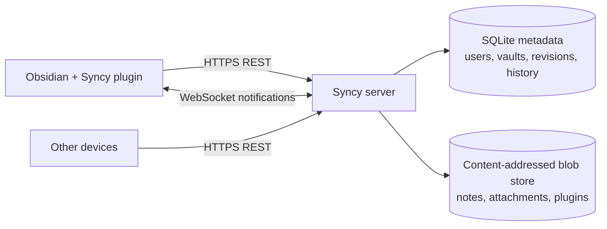

<div align="center">

<h1>Syncy</h1>

<p><strong>Your vault. Your server. Everything in sync.</strong></p>

<p>Self-hosted sync for Obsidian notes, attachments, plugins, settings, themes and history.</p>

<p>
  
  
  
  
  
  
  
</p>

</div>

> [!WARNING]
> **Vibecoded.** Syncy was built with heavy AI assistance. It has an integration test suite and is designed carefully, but it is young software. Review the code, run the tests, keep independent backups, and do not treat this server as the only copy of important data.

Syncy is the self-hosted server side of a two-part Obsidian sync stack. The Obsidian plugin lives in a separate repository. This server is content-agnostic, so note sync, plugin sync, theme sync and vault-configuration sync all use the same reliable file protocol.

> [!IMPORTANT]
> Syncy is **not** compatible with Obsidian's official, private Sync protocol. It implements a clean API for its own companion plugin. It is also not affiliated with or endorsed by Obsidian.

## Contents

- [Why Syncy](#why-syncy)
- [What gets synced](#what-gets-synced)
- [Architecture](#architecture)
- [Quick start](#quick-start)
- [Single-user setup](#single-user-setup)
- [Vault settings sync](#vault-settings-sync)
- [Large-vault reliability](#large-vault-reliability)
- [Configuration](#configuration)
- [Sync model](#sync-model)
- [Operations](#operations)
- [Security](#security)
- [Documentation](#documentation)
- [Development](#development)
- [License](#license)

## Why Syncy

| | |
| --- | --- |
| **Your infrastructure** | Your server, your disk, your rules. No monthly per-vault sync bill. |
| **Everything syncs** | Notes, attachments, folders, community plugins, plugin data, themes, snippets, hotkeys and settings. |
| **Conflict-safe** | Per-file revisions, path conflict detection, atomic multi-file batches and tombstones. |
| **History included** | Every accepted change is versioned. Browse, download and restore old note or file versions. |
| **Encryption optional** | E2EE vaults store opaque paths and ciphertext. The server never receives the vault key. |
| **Large vaults first** | Paginated snapshots, streaming blobs, target-only conflict checks and indexed change feeds. |
| **Real-time** | WebSocket notifications wake clients immediately. The durable change feed does the rest. |
| **Multi-device** | Device registration, rotating refresh tokens, reuse detection and instant device revocation. |
| **Single-user friendly** | Put one account in `.env`. Syncy creates it on boot and keeps its password in sync. |
| **Boring to run** | One Node process, SQLite, a data directory, Docker Compose and a health check. |

## What gets synced

| Category | Examples | How it syncs |
| --- | --- | --- |
| Notes | Markdown, Canvas, databases, text files | File content + path + version history |
| Attachments | Images, audio, video, PDFs, archives | Content-addressed blobs, deduplicated |
| Folders | Empty folders and directory structure | Folder records in the change feed |
| Plugin bundles | `.obsidian/plugins/**/main.js`, `manifest.json`, `styles.css` | Normal file sync |
| Plugin data | `.obsidian/plugins/**/data.json` | Normal file sync; use E2EE for credentials |
| Vault settings | `.obsidian/app.json`, `appearance.json`, `hotkeys.json`, `core-plugins.json`, `community-plugins.json` | File sync or the structured settings API |
| Themes and snippets | `.obsidian/themes/**`, `.obsidian/snippets/**` | Normal file sync |
| Workspace state | `workspace.json`, `workspace-mobile.json` | Optional, usually device-specific |
| Deletions | Files removed on any device | Tombstones in the change feed |
| Renames | Path changes, including swaps | Stable file IDs and atomic path resolution |

The server does not parse Markdown or plugin bundles. That means new Obsidian file formats, community plugins and future vault features work without server changes.

## Architecture



- **Fastify + TypeScript** serve a versioned `/v1` API.
- **SQLite in WAL mode** stores accounts, devices, vaults, memberships, file metadata, versions and the change log.
- **Content-addressed storage** stores blobs by SHA-256, deduplicating identical files and historical versions.
- **WebSocket tickets** keep real-time notifications short-lived and separate from access tokens.
- **Single instance by design**: one server process owns one data directory. That keeps self-hosting simple and predictable.

## Quick start

Requirements: Docker with Compose v2. Data lives in the `syncy-data` volume.

```bash
cp .env.example .env
# Edit .env: set SYNCY_EMAIL and SYNCY_PASSWORD at minimum
docker compose up -d --build
docker compose logs -f syncy
```

Check it:

```bash
curl http://localhost:8080/healthz
```

The account in `.env` is created on first start. Changing `SYNCY_PASSWORD` in `.env` and restarting updates the stored password and revokes existing sessions.

Set `PUBLIC_URL` to the address clients use. For a public deployment, also read [Self-hosting operations](docs/SELF_HOSTING.md) for HTTPS, reverse proxies and backups.

### Without Docker

```bash
npm install
cp .env.example .env
# Edit .env
npm run dev
```

Node.js 22 or newer is required. The server listens on `http://localhost:8080` by default and stores data in `./data`.

## Single-user setup

Syncy is designed to be pleasant for one person and one server:

```dotenv
SYNCY_EMAIL=you@example.com
SYNCY_PASSWORD=a-long-random-password
SYNCY_NAME=You
ALLOW_REGISTRATION=false
```

On every start Syncy:

1. Creates the account if it does not exist.
2. Keeps it as an administrator.
3. Re-enables it if it was disabled.
4. Rehashes the password and revokes sessions if the `.env` password changed.

To add another account for vault sharing, use the CLI:

```bash
docker compose exec syncy node dist/cli.js create-user \
  --email friend@example.com --password 'a-long-password' --name Friend
```

If you prefer first-run setup, omit the `.env` credentials and call `POST /v1/setup` once. Set `SETUP_TOKEN` on public servers to prevent someone else from claiming the first administrator.

## Vault settings sync

Syncy supports both common models:

1. **Raw file sync, closest to Obsidian Sync** — sync `.obsidian/app.json`, `appearance.json`, `hotkeys.json`, `core-plugins.json`, `community-plugins.json`, `themes.json`, snippets and theme files through the normal file API. You get version history and the same conflict rules as notes.
2. **Structured settings document** — store one revision-controlled document at `/v1/vaults/:id/settings` with sections for appearance, hotkeys, core plugins, community plugins, snippets, themes and plugin data. The server tracks its revision independently and broadcasts `vault_settings_changed`.

```bash
curl -X PUT http://localhost:8080/v1/vaults/$VAULT/settings \
  -H "authorization: Bearer $TOKEN" \
  -H 'content-type: application/json' \
  -d '{
    "expectedRevision": 3,
    "settings": {
      "appearance": { "theme": "obsidian", "baseFontSize": 17 },
      "communityPlugins": { "enabled": ["obsidian-git"] }
    }
  }'
```

- Optimistic concurrency prevents silent settings overwrites.
- Readers can fetch settings; editors and owners can change them.
- For E2EE vaults, encrypt settings client-side; the server stores the opaque document.
- Settings can also live entirely in raw `.obsidian` files. Pick one source of truth to avoid loops.

See the [API reference](docs/API.md#vault-settings) and the [plugin guide](docs/PLUGIN_GUIDE.md#7-selective-sync).

## Large-vault reliability

Syncy is built so a large vault does not become one giant JSON response or an O(vault) operation on every save.

| Concern | Approach |
| --- | --- |
| Initial sync | Paginated snapshot, 1–5000 files per page, stable first-page revision |
| Remote updates | Paginated change feed ordered by revision |
| Local pushes | Batched changes with per-file expected revisions |
| Path checks | Only paths touched by the batch are queried, not the entire vault |
| Large attachments | Streaming uploads and range downloads, never buffered whole |
| Storage growth | Content-addressable deduplication, version retention and GC |
| SQLite performance | WAL mode plus indexes for revisions, paths, versions and blobs |
| Request limits | 8 MiB JSON bodies, 512 MiB blobs, 6000 requests/minute by default |
| Real-time | WebSocket is a hint; clients pull the durable change feed |
| Crash safety | Idempotent applies, durable cursors and atomic file writes on the client |

The integration suite includes a 1200-file batch plus paginated snapshot and change-feed checks. The [plugin guide](docs/PLUGIN_GUIDE.md#8-large-vaults) documents batching, concurrency and crash-resume rules for 100k-file vaults.

> [!TIP]
> For very fast initial imports, raise `RATE_LIMIT_MAX`. For vaults with many large attachments, keep `DATA_DIR` on an SSD and back it up regularly.

## Configuration

All settings come from environment variables. A `.env` file in the working directory is loaded automatically. Docker Compose reads `.env` via `env_file`.

| Variable | Default | Description |
| --- | --- | --- |
| `SYNCY_EMAIL` | unset | Email of the single configured account. Set with `SYNCY_PASSWORD`. |
| `SYNCY_PASSWORD` | unset | Password (minimum 10 characters) for the configured account. |
| `SYNCY_NAME` | derived from email | Display name for the configured account. |
| `ALLOW_REGISTRATION` | `false` | Enable open sign-ups. Leave off for a personal server. |
| `SETUP_TOKEN` | unset | Require this token for first-run `POST /v1/setup` when no `.env` user exists. |
| `HOST` | `0.0.0.0` | Listen address. |
| `PORT` | `8080` | Listen port inside the process/container. |
| `SYNCY_PORT` | `8080` | Host port used by `docker-compose.yml`. |
| `DATA_DIR` | `./data` | SQLite database, JWT secret and blob storage. Compose uses `/data`. |
| `PUBLIC_URL` | `http://localhost:$PORT` | Public base URL used in discovery responses. |
| `JWT_SECRET` | auto-generated | At least 32 characters. Generated once in `DATA_DIR/.jwt-secret` if omitted. |
| `CORS_ORIGINS` | empty | Comma-separated allowed origins, or `*`. Native clients do not need it. |
| `MAX_BLOB_BYTES` | `536870912` (512 MiB) | Maximum size of one blob. |
| `MAX_JSON_BODY_BYTES` | `8388608` (8 MiB) | Maximum JSON request size. |
| `ACCESS_TOKEN_TTL_SECONDS` | `900` | Access-token lifetime. |
| `REFRESH_TOKEN_TTL_DAYS` | `30` | Refresh-token lifetime; rotated on each use. |
| `RATE_LIMIT_MAX` | `6000` | Global requests per minute per client IP. |
| `TRUST_PROXY` | `false` | Set `true` behind a trusted reverse proxy. |
| `LOG_LEVEL` | `info` | `fatal`, `error`, `warn`, `info`, `debug`, `trace` or `silent`. |

## Sync model

```text
1. Authenticate with email + password. Keep the rotating refresh token safe.
2. Create or join a vault. Subscribe to it over WebSocket.
3. For each changed file:
     a. Compute SHA-256.
     b. Upload the blob if it is not already on the server.
     c. Push a change with expectedRevision (or null for a new file).
4. Other devices receive a vault_changed hint and pull changes since their cursor.
5. On a conflict, pull the server state and merge, overwrite deliberately, or create a conflict copy.
6. Every accepted change becomes a version, visible in version history.
```

Key properties:

- **Stable file IDs.** Renames keep history and identity. Path swaps are supported in one atomic batch.
- **Per-file optimistic concurrency.** A stale `expectedRevision` returns `409` with the server's current file, never a silent overwrite.
- **Tombstones.** Deletes are durable events, not ambiguous "file missing" states.
- **Atomic batches.** A multi-file rename either applies completely or not at all (default).
- **Cursor sync.** Clients fetch only revisions after their cursor; full resync is a paginated snapshot.
- **Content deduplication.** The same bytes are stored once, even across historical versions.

Full request and response details are in [docs/API.md](docs/API.md).

## Operations

```bash
# Create an additional user for vault sharing
npm run cli -- create-user --email friend@example.com --password 'a-long-password' --name Friend

# List users and storage stats
npm run cli -- list-users
npm run cli -- stats

# Preview retention / orphan cleanup
npm run cli -- gc --retention-days 90

# Apply retention and vacuum
npm run cli -- gc --retention-days 90 --yes --vacuum

# Back up the database, JWT secret and blobs
npm run cli -- backup --out ./backups/manual
```

Inside Docker, prefix with `docker compose exec syncy node dist/cli.js ...`.

Backups, restore, reverse proxy, upgrades and recovery are covered in [Self-hosting operations](docs/SELF_HOSTING.md).

## Security

- Run behind HTTPS. Treat `.env` and the data directory as secrets.
- Use E2EE for vaults that contain plugin credentials or sensitive notes.
- Keep `ALLOW_REGISTRATION=false` unless you intentionally want new accounts.
- Passwords use scrypt. Refresh tokens are opaque, hashed at rest and rotated with reuse detection.
- Access tokens are bound to a device and a server-side token version. Password changes, logout-all and account disable revoke them immediately.
- WebSocket tickets are single-use and expire after 60 seconds.
- Blob access is authorized per vault. A blob is downloadable only if a version in that vault references it.
- Server administrators can read non-E2EE vault content. E2EE protects content and paths, not metadata such as sizes, counts or timestamps.

Read the [E2EE threat model](docs/E2EE.md) before trusting Syncy with highly sensitive data.

## Documentation

- [API reference](docs/API.md) — auth, vaults, members, snapshots, change feed, blobs, versions, settings, WebSocket and errors.
- [Plugin implementation guide](docs/PLUGIN_GUIDE.md) — state, stable file IDs, hashing, batching, conflicts, settings, E2EE and large-vault rules.
- [Architecture](docs/ARCHITECTURE.md) — data model, sync algorithm, path resolution, storage and scaling limits.
- [End-to-end encryption](docs/E2EE.md) — keys, envelopes, threat model and metadata leakage.
- [Self-hosting operations](docs/SELF_HOSTING.md) — Compose, HTTPS, backups, GC, upgrades and troubleshooting.

## Development

```bash
npm install
npm run typecheck
npm run lint
npm test
npm run build
```

The test suite covers first-run setup, the single-user `.env` flow, password rotation and token revocation, refresh reuse detection, devices, vault roles and sharing, blob uploads/ranges/deduplication, revisions and conflicts, path swaps, tombstones, version restore, E2EE opaque paths, vault settings, WebSocket notifications, garbage collection and a 1200-file large-vault scenario.

## Contributing

This is an early project. Bug reports, protocol feedback, security reviews and pull requests are welcome. Please keep the sync semantics and tests intact, and add coverage for behavior changes.

## License

MIT — see [LICENSE](LICENSE).

Syncy is an independent project and is not affiliated with Obsidian.
